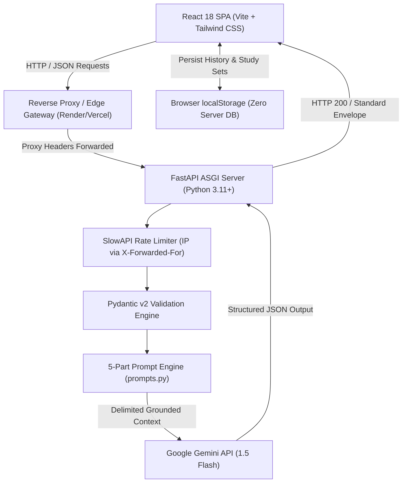

# StudyMate AI: Academic Study Assistant & Active Recall Utility

StudyMate AI turns unorganized notes, lectures, and draft responses into structured summaries, active recall quizzes, phrase-level answer improvements, and multi-level concept breakdowns.

Powered by Google's Gemini API, FastAPI, React 18, and Tailwind CSS. Built to strictly comply with academic utility standards: zero fake data, no intrusive gradients, no purple hues, no emoji icons, and zero em dashes.

---

## 1. Project Overview & Purpose

StudyMate AI is designed to combat passive studying and information overload. College students routinely accumulate lengthy, unstructured lecture transcripts and textbook passages. StudyMate AI processes this material into deterministic academic study artifacts:
- 6-section structured academic summaries.
- 4-option active recall practice quizzes with instant answer feedback.
- Factual-preserving answer revisions with redline phrase comparisons.
- Multi-depth conceptual explanations tailored from beginner analogies to graduate rigor.

---

## 2. Key Features & Architecture

- **Notes Summarizer**: Breaks down complex notes into 6 standardized sections: Topic Overview, Key Concepts, Important Definitions, Important Points, Exam Preparation Notes, and Quick Revision Summary.
- **Practice Quiz Generator**: Creates 5, 10, or 15 multiple-choice questions with 4 options per question, instant explanation feedback, and an interactive Flashcard review mode.
- **Answer Improver**: Enhances grammar, clarity, and academic tone while strictly retaining original student facts without inventing claims.
- **Concept Explainer**: Explains mechanisms across Beginner, Intermediate, and Advanced learning depths.
- **Shared Multi-Tool Study Sets**: Groups summaries, practice quizzes, and concept notes under unified collections in client storage.
- **Real Backend Health & Metrics**: Live 3-state health indicator in top bar (`checking`, `online`, `unreachable`).

---

## 3. Architecture Diagram



---

## 4. Workflow: Input to Processing to Output

1. **Input Phase**: The student enters or pastes study text into a character-bounded textarea. Dynamic character counters provide tabular real-time feedback.
2. **Client Validation**: The UI verifies minimum character lengths (e.g. 20 chars for Summarizer) and disables submission with explanatory messages if constraints are violated.
3. **Server Validation & Security**: The FastAPI backend strips whitespace, verifies Pydantic schemas, and checks client IP rate limits.
4. **Delimited Prompt Execution**: Prompts isolate student input inside `=== STUDENT INPUT START ===` fences, forbidding the LLM from inventing outside facts.
5. **Structured Delivery**: The LLM outputs strict JSON, which the backend validates and returns within a standardized envelope.
6. **Interaction & Export**: The student can copy Markdown with single-click feedback, toggle reading font sizes (S / M / L), regenerate results, or practice with interactive flashcards.

---

## 5. Prompt Engineering Approach & Anti-Hallucination Guardrails

All prompt templates in `backend/app/prompts.py` enforce a strict 5-part structure:
1. **Role**: Establishes the authoritative academic persona.
2. **Task**: Explicitly states the transformation required.
3. **Context**: Houses the student input wrapped in isolation fences.
4. **Instructions**: Imposes strict negative constraints:
   - "Do not invent facts, outside claims, or external assertions that are not present in the input text."
   - "DO NOT add facts, outside assertions, or new evidence not present in the student draft answer."
   - "Do not use em dashes anywhere in your output. Use commas, colons, or parentheses."
5. **Output Format**: Demands raw JSON strictly matching the exact Pydantic schema without Markdown fences.

---

## 6. Real AI Integration Details

- **Official Model**: Configured through `GEMINI_MODEL` (default: `gemini-1.5-flash`). Supported models: `gemini-1.5-flash`, `gemini-1.5-flash-8b`, `gemini-1.5-pro`, `gemini-2.0-flash`.
- **Startup Model Validation**: The backend validates `GEMINI_MODEL` against supported Google Gen AI models on boot, failing fast if an unverified model is requested.
- **Strict Real AI Enforcement**: All runtime mock fallbacks have been removed. If `GEMINI_API_KEY` is unconfigured or rejected, endpoints return a clean HTTP 503 error. Mocks exist strictly within isolated Pytest fixtures.

---

## 7. API Reference

### Core Endpoints

| Method | Endpoint | Description | Request Payload | Response Schema |
| :--- | :--- | :--- | :--- | :--- |
| `GET` | `/api/health` | System health and environment status | None | `HealthResponse` |
| `GET` | `/health` | Root health check alias | None | `{"status": "ok"}` |
| `GET` | `/api/config` | Central source of truth for input limits | None | `ConfigResponse` |
| `POST` | `/api/summarize` | Generates 6-section academic summary | `SummarizeRequest` | `SummarizeResponse` |
| `POST` | `/api/generate-quiz` | Generates 4-option multiple choice quiz | `QuizRequest` | `QuizResponse` |
| `POST` | `/api/improve-answer` | Evaluates answer without adding facts | `ImproveAnswerRequest` | `ImproveAnswerResponse` |
| `POST` | `/api/explain` | Generates multi-depth conceptual breakdown | `ExplainConceptRequest` | `ExplainConceptResponse` |

---

## 8. Input Validation & Sanitization

All input models inherit from `BaseValidatedModel` with `str_strip_whitespace=True` and `extra="forbid"`.
- **Notes Summarizer**: 20 to 10,000 characters. Rejects whitespace-only text with HTTP 422.
- **Quiz Generator**: 20 to 10,000 characters. Question counts strictly restricted to `[5, 10, 15]`. Difficulty restricted to `["easy", "medium", "hard"]`. Optional focus topic capped at 200 characters.
- **Answer Improver**: 10 to 5,000 characters. Optional subject context capped at 200 characters.
- **Concept Explainer**: 3 to 300 characters. Depth restricted to `["beginner", "intermediate", "advanced"]`.

---

## 9. Error Handling Strategy & Standard Envelope

All errors adhere to a standardized, predictable JSON envelope:
```json
{
  "success": false,
  "detail": "Actionable error message for the user.",
  "error": {
    "code": "ERROR_CODE_STRING",
    "message": "Actionable error message for the user.",
    "details": null
  }
}
```

### Status Code Mapping
- `422 Unprocessable Content`: Validation failure (empty, whitespace-only, too short, too long).
- `429 Too Many Requests`: Client exceeded rate limit (15/min on AI routes).
- `502 Bad Gateway`: Model returned unparseable output across 2 retries.
- `503 Service Unavailable`: `GEMINI_API_KEY` is missing or upstream service is down.
- `504 Gateway Timeout`: Upstream AI call timed out (>30s).
- `500 Internal Server Error`: Generic internal server failure without leaking stack traces.

---

## 10. Local Storage & Privacy Model

- **Privacy Statement**: "Your text is sent to Google's Gemini API to generate results. StudyMate AI does not store it on a server. History and study sets stay in this browser."
- **Zero Cloud Databases**: StudyMate AI does not operate a database or require user authentication.
- **Browser Persistence**: Recent sessions, quiz attempt statistics, and study collections are stored in `window.localStorage` under versioned keys (`studymate_recent_sessions_v1`, `studymate_study_sets_v1`).

---

## 11. Design System & Typography Tokens

- **Sidebar Background**: `#14161B` (fixed 248px desktop width, 3px active indicator bar).
- **Canvas Background**: `#F2EFE8` (warm editorial parchment).
- **Document Panels**: `#FFFFFF` with hairline border `rgba(22, 24, 29, 0.10)`.
- **Accent Color**: Deep academic blue `#1F3FBF` (hover: `#1A36A6`, tint: `#EEF1FB`).
- **Typography**: Headings set in `Source Serif 4`; UI controls and metrics set in `Inter`.
- **Guidelines**: See [docs/DESIGN.md](docs/DESIGN.md) for full design token specifications.

---

## 12. Tech Stack & Dependencies

- **Frontend**: React 18, Vite 6, Tailwind CSS 3.4, Motion 12, Lucide Icons, Canvas Confetti.
- **Backend**: FastAPI 0.115, Uvicorn, SlowAPI, Pydantic v2, Google GenAI SDK.
- **Testing & Quality**: Pytest 9, Pytest-Asyncio, HTTPX, pip-audit, npm audit.

---

## 13. Prerequisites

- Python 3.10+ (tested through Python 3.14)
- Node.js 18+ (tested on Node.js 20 LTS)
- Google Gemini API Key (from [Google AI Studio](https://aistudio.google.com))

---

## 14. Installation & Setup

### 1. Clone the repository
```bash
git clone https://github.com/harshchavan009/StudyMate-AI.git
cd StudyMate-AI
```

### 2. Configure Backend
```bash
cd backend
python3 -m venv venv
source venv/bin/activate
pip install -r requirements.txt
cp .env.example .env
# Edit .env and paste your GEMINI_API_KEY
```

### 3. Configure Frontend
```bash
cd ../frontend
npm install
cp .env.example .env
```

---

## 15. Environment Variables Reference

### Backend (`backend/.env`)
| Variable | Default | Description |
| :--- | :--- | :--- |
| `GEMINI_API_KEY` | `""` | Google Gemini API key (Required for AI generation) |
| `GEMINI_MODEL` | `gemini-1.5-flash` | Configured Gemini model name |
| `FRONTEND_URL` | `http://localhost:5173` | Allowed CORS origin (no wildcards in production) |
| `ENVIRONMENT` | `development` | Set to `production` for strict CORS and disabled docs |
| `RATE_LIMIT_DEFAULT` | `30/minute` | Global endpoint rate limit |
| `RATE_LIMIT_AI_ENDPOINTS` | `15/minute` | AI generation endpoint rate limit |

### Frontend (`frontend/.env`)
| Variable | Default | Description |
| :--- | :--- | :--- |
| `VITE_API_BASE_URL` | `http://localhost:8000` | Backend API base URL |

---

## 16. Running the Application Locally

In two separate terminal sessions:

```bash
# Terminal 1: Backend
cd backend
source venv/bin/activate
uvicorn app.main:app --host 127.0.0.1 --port 8000 --reload

# Terminal 2: Frontend
cd frontend
npm run dev
```

Open your browser to `http://localhost:5173`.

---

## 17. Running the Automated Test Suite

The test suite contains 30 passing automated tests covering all features, prompts, rate limiting, and failure modes.

```bash
cd backend
source venv/bin/activate
pytest -v
```

### Test Suite Structure
- `backend/tests/test_prompts.py`: Verifies 5-part structure, safety delimiters, and anti-hallucination guardrails across all 4 prompt builders.
- `backend/tests/test_api.py`: Tests 422 validations, whitespace-only rejections, 503 missing key handling, 429 quota exhaustion, 504 timeouts, 502 malformed retries, quiz question count validation and deduplication, security headers, central config, and rate limiting with `X-Forwarded-For`.

---

## 18. Smoke Testing Script Execution

A dedicated smoke test script validates all live endpoints against a running backend server:

```bash
# Ensure backend is running on port 8000, then:
bash backend/scripts/smoke.sh
```

---

## 19. Production Deployment Guide

Detailed deployment walkthroughs for Render and Vercel are available in [DEMO.md](DEMO.md).

- **Backend**: Deploy on Render as a Web Service with start command:
  `uvicorn app.main:app --host 0.0.0.0 --port $PORT --proxy-headers --forwarded-allow-ips "*"`
- **Frontend**: Deploy on Vercel as a Vite SPA with rewrite rules in `vercel.json`.

---

## 20. License & Academic Integrity Notice

StudyMate AI is designed as an educational revision aid. It is intended to help students synthesize lecture material, test recall, and polish their own original phrasing. It is not intended to complete assignments or generate ungrounded claims.

Distributed under the MIT License.
