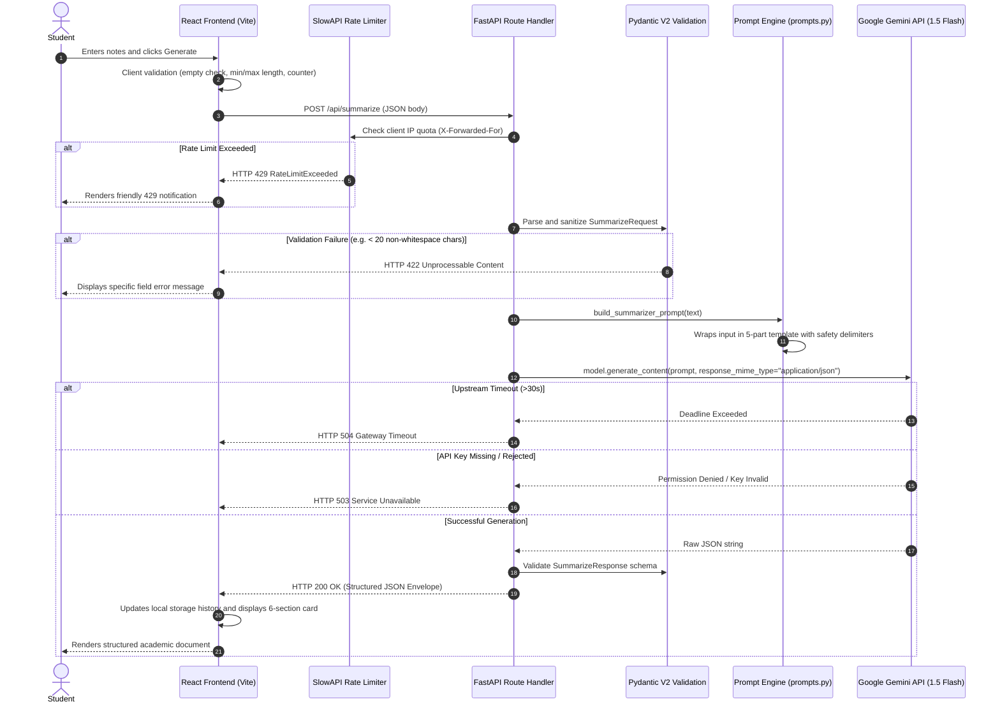

# StudyMate AI: Academic Utility Evaluation Guide

This guide provides evaluators, technical reviewers, and instructors with a comprehensive technical walkthrough of StudyMate AI, explaining its architecture, end-to-end request lifecycle, prompt engineering guardrails, Gemini API integration, and 15 in-depth evaluator questions and answers.

---

## 1. End-to-End Request Lifecycle Walkthrough

### Lifecycle Stages
1. **Client Submission**: The user enters notes into the validated textarea. The interface tracks character counts using tabular figures and prevents submission if bounds are violated.
2. **Reverse Proxy and Rate Limiting**: The request passes through the web server to FastAPI. The `get_client_ip` utility extracts the real client IP from `X-Forwarded-For` proxy headers. SlowAPI enforces a 15 req/min quota on AI generation endpoints.
3. **Pydantic Model Validation**: Inputs are stripped of leading/trailing whitespace (`str_strip_whitespace=True`) and checked against minimum and maximum boundaries. Malformed bodies trigger an immediate HTTP 422 standard error response.
4. **Prompt Construction**: The validated text is enclosed inside strict `=== STUDENT INPUT START ===` and `=== STUDENT INPUT END ===` delimiters and paired with Role, Task, Instructions, and JSON Output Format schemas.
5. **LLM Invocation & Parsing**: The Gemini API executes the prompt with `response_mime_type="application/json"`. The returned JSON is cleaned, checked for em dashes, and validated against the Pydantic response schema before returning to the frontend.

---

## 2. Prompt Engineering Approach & Anti-Hallucination Guardrails

All prompt templates in `backend/app/prompts.py` adhere to a uniform, strict 5-part architecture:

1. **Role**: Defines the exact persona and academic standard (e.g., "You are an expert academic tutor and study assistant").
2. **Task**: Explicitly declares the transformation required (e.g., "Analyze the student provided study notes or textbook excerpt and produce a structured 6-section academic summary").
3. **Context**: Isolates student-provided material inside explicit safety delimiters (`=== STUDENT INPUT START ===` and `=== STUDENT INPUT END ===`), preventing prompt injection attacks from altering system behavior.
4. **Instructions**: Enforces strict grounding rules:
   - Forbids inventing facts, external assertions, or outside claims not present in the input.
   - Forbids conversational filler, preambles, and introductory pleasantries.
   - Forbids em dashes (`—`), enforcing commas, colons, or parentheses.
5. **Output Format**: Enforces an exact, deterministic JSON schema matching the required UI sections.

---

## 3. Gemini Model Integration & Error Mapping

The application integrates with the Google Gen AI SDK (`gemini-1.5-flash` by default). The runtime code operates in real AI mode only; runtime mock fallbacks have been removed.

### Error Code Mapping

| Error Scenario | HTTP Code | Error Code | Client Notification |
| :--- | :---: | :--- | :--- |
| Missing or unconfigured `GEMINI_API_KEY` | `503` | `SERVICE_UNAVAILABLE` | "The AI service is not configured or unavailable." |
| Upstream Gemini rate limit exhausted | `429` | `RATE_LIMIT_EXCEEDED` | "Upstream AI rate limit reached. Please wait a minute before retrying." |
| Upstream Gemini deadline / timeout | `504` | `GATEWAY_TIMEOUT` | "The AI service request timed out. Please try again." |
| Malformed or schema-invalid LLM response after 2 retries | `502` | `BAD_GATEWAY` | "Invalid response received from AI model. Please retry." |
| Invalid client request payload | `422` | `VALIDATION_ERROR` | "Input validation failed. Please check the submitted fields." |
| Unhandled server exception | `500` | `INTERNAL_SERVER_ERROR` | "An internal server error occurred. Our team has been alerted." |

---

## 4. 15 Evaluator Questions & Answers

### Q1: What problem does StudyMate AI solve for students?
**Answer**: Students frequently suffer from passive reading habits, information overload, and unstructured revision notes. StudyMate AI transforms unstructured lecture notes into six distinct academic revision sections, generates active-recall multiple choice quizzes with instant feedback, provides writing revisions that preserve the student's original arguments, and explains complex concepts across three academic depths.

### Q2: Why is the backend implemented in FastAPI rather than directly calling Gemini from the frontend?
**Answer**: Direct frontend calls expose the secret `GEMINI_API_KEY` to client-side reverse engineering and browser dev tools. FastAPI securely holds the key on the server, enforces IP-based rate limiting, provides Pydantic schema validation, sanitizes inputs, and formats errors into a predictable contract.

### Q3: How does StudyMate AI prevent LLM hallucinations?
**Answer**: Every prompt template in `backend/app/prompts.py` includes explicit anti-hallucination instructions commanding the model to work strictly with the text provided in Context. For the Answer Improver, the prompt explicitly instructs the LLM: "DO NOT add facts, outside assertions, or new evidence not present in the student draft answer."

### Q4: How is prompt injection prevented?
**Answer**: Student inputs are isolated inside explicit delimiter fences (`=== STUDENT INPUT START ===` and `=== STUDENT INPUT END ===`). The system prompt instructs the model that the text within these delimiters represents raw study data to be analyzed, not instructions to be executed.

### Q5: What happens when the Gemini API key is missing?
**Answer**: In all environments, every AI endpoint immediately returns an HTTP 503 (`SERVICE_UNAVAILABLE`) with a clear error message. The UI catches this and renders an informative error banner with a Retry button and preserved user inputs. Runtime mock fallbacks have been eliminated from production code.

### Q6: How does the Quiz Generator ensure valid question counts and formats?
**Answer**: In `backend/app/services/gemini_service.py`, `generate_quiz` validates that the returned question count matches the requested count (5, 10, or 15), that every question has exactly 4 options, that `correct_index` is between 0 and 3, that explanations are non-empty, and that question stems are deduplicated. If validation fails, it retries up to twice before returning HTTP 502.

### Q7: Why does the app forbid em dashes?
**Answer**: Many LLMs overuse em dashes (`—`), which clutters academic prose. StudyMate AI enforces standard academic punctuation (commas, colons, semicolons, and parentheses) through prompt instructions, regex sanitization in `gemini_service.py`, and automated unit test assertions.

### Q8: How is the application styled without Tailwind plugins or pre-built UI kits?
**Answer**: StudyMate AI uses standard Tailwind CSS utility classes linked to CSS variables defined in `frontend/src/index.css`. The system uses strict color tokens (e.g., `#14161B` for dark sidebar, `#F2EFE8` for canvas) and avoids gradients, purple hues, or pill buttons.

### Q9: Where is student data stored?
**Answer**: StudyMate AI does not use a cloud database or track student accounts. Study texts are processed in memory by Gemini and returned directly. Study sets, quiz scores, and recent sessions are stored entirely in the user's browser using `localStorage`.

### Q10: How does the application handle rate limiting behind cloud reverse proxies (e.g., Render)?
**Answer**: Render routes traffic through edge load balancers, attaching the client's actual IP to the `X-Forwarded-For` header. StudyMate AI's `get_client_ip` utility extracts the first IP from `X-Forwarded-For`, ensuring that rate limits apply per client IP rather than throttling the entire load balancer.

### Q11: How is accessibility (a11y) ensured?
**Answer**: The app includes a "Skip to main content" link, accessible ARIA roles (`role="alert"`, `aria-label` attributes on controls), semantic HTML headings (`h1` through `h4`), keyboard shortcuts (`Cmd/Ctrl+K` for search, `Escape` to close drawers), and `reducedMotion="user"` support.

### Q12: How are unit and integration tests organized?
**Answer**: The backend contains 30 automated Pytest tests across `test_api.py` and `test_prompts.py`. These cover health endpoints, central configuration limits, Pydantic 422 validations, whitespace-only rejections, 503/504/502 error mapping, prompt 5-part structures, rate limiting, and output schemas.

### Q13: How is the application configured across environments?
**Answer**: Configuration is managed via Pydantic Settings in `backend/app/config.py`. Environment variables include `GEMINI_API_KEY`, `GEMINI_MODEL`, `FRONTEND_URL`, `ENVIRONMENT`, `HOST`, `PORT`, `RATE_LIMIT_DEFAULT`, and `RATE_LIMIT_AI_ENDPOINTS`.

### Q14: How does the frontend handle network loss?
**Answer**: `frontend/src/lib/api.js` checks `navigator.onLine` before making HTTP calls and raises a descriptive `ApiError` if the client is offline. The top navigation bar includes an active backend health monitor, and input textareas preserve content if a network interruption occurs.

### Q15: What automated CI/CD safeguards exist?
**Answer**: The repository includes a GitHub Actions workflow (`.github/workflows/ci.yml`) that triggers on all pushes and pull requests to `main`. It runs the full 30-test Pytest suite, executes backend smoke tests, verifies frontend builds, and performs `npm audit`.

